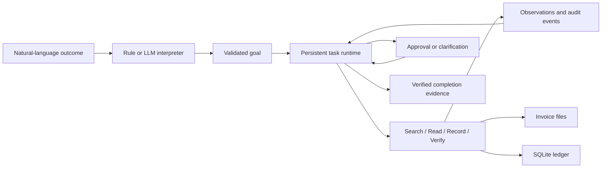

# CentrAlign AI Task Worker

A bounded autonomous invoice worker built for the CentrAlign AI Engineering Intern assignment. It interprets a natural-language outcome, finds invoice documents, extracts validated fields, writes an internal ledger, and verifies the saved result before reporting completion.

The company environment is synthetic, but execution is real: tools read files and write a SQLite ledger. The worker supports latest-invoice and all-unpaid-invoice imports for one vendor, transient failure recovery, duplicate prevention, human approval, and persistent task state.

## Setup and run

Requires Python 3.11 or newer. The application and tests use only the Python standard library; no package installation is required.

```sh
python server.py
```

Open `http://127.0.0.1:8765`. Offline mode works without an API key. The interface displays task progress, tool observations, approval requests, the invoice ledger, and downloadable completion evidence.

To select a separate data directory or port:

```sh
python server.py --port 8766 --data-dir data/company
```

Stop with Ctrl+C. Restarting with the same data directory preserves records, task checkpoints, and pending approvals. Run only one server process per data directory.

## Model configuration

Copy `.env.example` to `.env` and configure:

```dotenv
WORKER_API_KEY=your-provider-key
WORKER_MODEL=gemini-3.5-flash-lite
WORKER_API_BASE=https://generativelanguage.googleapis.com/v1beta/openai
```

The server automatically loads these settings; existing environment variables take precedence. A configured server selects LLM mode by default. The local `.env` file is ignored by Git. Keys are not sent to the browser or stored in the task database or audit evidence.

The adapter supports OpenAI-compatible Chat Completions with JSON mode and `max_completion_tokens`. Google Gemini 3.5 Flash-Lite was verified with real latest-invoice, batch, approval-gated, and browser-initiated invoice tasks. The model translates the request into a typed goal; execution, permission checks, and verification remain deterministic. Other provider/model combinations require their own validation. See [Google's compatibility documentation](https://ai.google.dev/gemini-api/docs/openai).

Each interpretation request has a 30-second timeout and a 500-token output limit. The model receives only the task and known vendor names. Invalid, refused, incomplete, and malformed responses stop the task for human input rather than silently switching interpreters.

## Architecture



| Module | Responsibility |
| --- | --- |
| `worker/planner.py` | Interpret intent and validate the operation, vendor, and selection. |
| `worker/runtime.py` | Choose the next action from observations, enforce execution budgets, checkpoint state, and handle human decisions. |
| `worker/tools.py` | Search/read sources, enforce mutation policy, record invoices, and independently verify the ledger. |
| `worker/store.py` | Persist tasks, audit events, document metadata, and ledger records. |
| `worker/config.py` | Load only recognized local configuration settings without executing configuration content. |
| `worker/fixtures.py` | Initialize synthetic invoice files and their document index. |
| `server.py` | Serve the local UI and HTTP API with a serialized background executor. |
| `web/` | Display tasks, observations, approval decisions, saved invoices, and evidence. |

## Technical decisions

**Observation-driven execution.** The runtime searches when sources are unknown, reads missing invoices, checks all batch members before writing, requests necessary approval, records missing entries, and verifies outcomes. Transient failures trigger retries; invalid sources and conflicts request human correction.

**A constrained model boundary.** The model proposes a goal; it cannot execute arbitrary code, issue payments, modify policy, or write SQL. Offline interpretation is rule-based and deliberately conservative. Recognized unsupported qualifiers, negations, date/currency filters, and dry-run requests stop for clarification. Document prose is never interpreted as agent instructions.

**Independent verification.** A new source read and ledger query must match vendor, invoice number, integer amount, currency, issue date, due date, and SHA-256 source hash. Before completion, the runtime checks all selected invoices again and confirms the source set has not changed. Tool success alone is insufficient.

**Integer money.** Amounts are parsed with `Decimal` and stored in paise, preventing floating-point rounding errors.

**Snapshot-bound approval.** Invoices at or above INR 100,000 require approval before any task writes. Approval applies to the extracted source hash. The mutation tool independently checks policy and rereads the source; a changed invoice blocks the write.

**Replay-safe writes.** Source IDs and vendor/invoice-number pairs are unique. Replaying a write after a crash returns an existing matching record instead of inserting a duplicate. Conflicting values require reconciliation.

**Durable recovery budgets.** Three attempts per tool operation and 60 steps per task are persisted across restarts. Only classified transient failures and SQLite lock errors retry.

## Verification

```sh
python -m unittest discover -v
```

27 automated tests passed locally on Windows with Python 3.13.3. Coverage includes invoice selection, unpaid batches, exact amounts, actual file/database operations, idempotency, transient failures and retry exhaustion, approval/decline, approval invalidation, source corruption, request qualifiers, conflicting records, path containment, document instructions treated as data, commit/checkpoint recovery, durable budgets, tampered ledger detection, local configuration loading, malformed model responses, and HTTP/CSRF behavior.

The model adapter is tested against a local HTTP fixture for repeatability. Real Gemini integration was separately verified on synthetic tasks. CI runs the suite on Windows and Ubuntu with Python 3.11 and 3.13. CI results are visible in the repository's Actions tab.

## Assumptions and limitations

- A document index supplies vendor, issue date, and payment status; source fields are checked against that index. Latest means greatest issue date. Ties require human input.
- Invoices use a labeled UTF-8 text format. PDF extraction, email discovery, arbitrary websites, desktop automation, and production accounting connectors are outside this prototype.
- Goals are restricted to the latest invoice regardless of payment status, or all unpaid invoices, for one vendor. The parser is not a complete natural-language restriction validator.
- The worker records invoices and never pays them. The approval threshold is an example company policy.
- Batches are preflighted but are not atomic across every write. Later source changes or conflicts can leave earlier records saved; the task reports possible partial progress and does not claim completion.
- Approval resumes the existing task. Clarification or source correction is followed by a new task. Existing source edits are preserved on restart.
- A recovered committed write may be counted as already present. Ledger records and audit history provide operation evidence.
- The server is single-user and loopback-only, with host checking on writes, a CSRF token, and source-path containment. It is not intended for public deployment without authentication, tenant isolation, and a security review.
- Verification detects mismatches within the sandbox trust domain; it cannot detect a coordinated malicious alteration of both the source and ledger.
- Individual tool decisions are deterministic. There is no general workflow discovery, alternative-tool planning, or learning from feedback. Transient retries are immediate; production would require backoff and jitter.

## Further development

1. Add mailbox connectors and PDF extraction with source excerpts, confidence estimates, and human corrections.
2. Add model-selected actions over a typed tool registry, keeping permissions and outcome verification outside the model.
3. Add atomic batch handling or compensating operations, task leases, cancellation, and exponential backoff.
4. Evaluate verified success and unwanted-action rates against ambiguous goals, service outages, adversarial documents, and changing source sets.
5. Introduce versioned company policies and context, then add application connectors incrementally.

## Components

Python standard library: `http.server`, `sqlite3`, `urllib`, `concurrent.futures`, `decimal`, and `hashlib`. Frontend: vanilla HTML, CSS, and JavaScript. No agent framework or workflow engine is required. Optional external service: a configured chat-completion provider; Google Gemini 3.5 Flash-Lite is the verified integration.

OpenAI Codex assisted with implementation, tests, and documentation.
